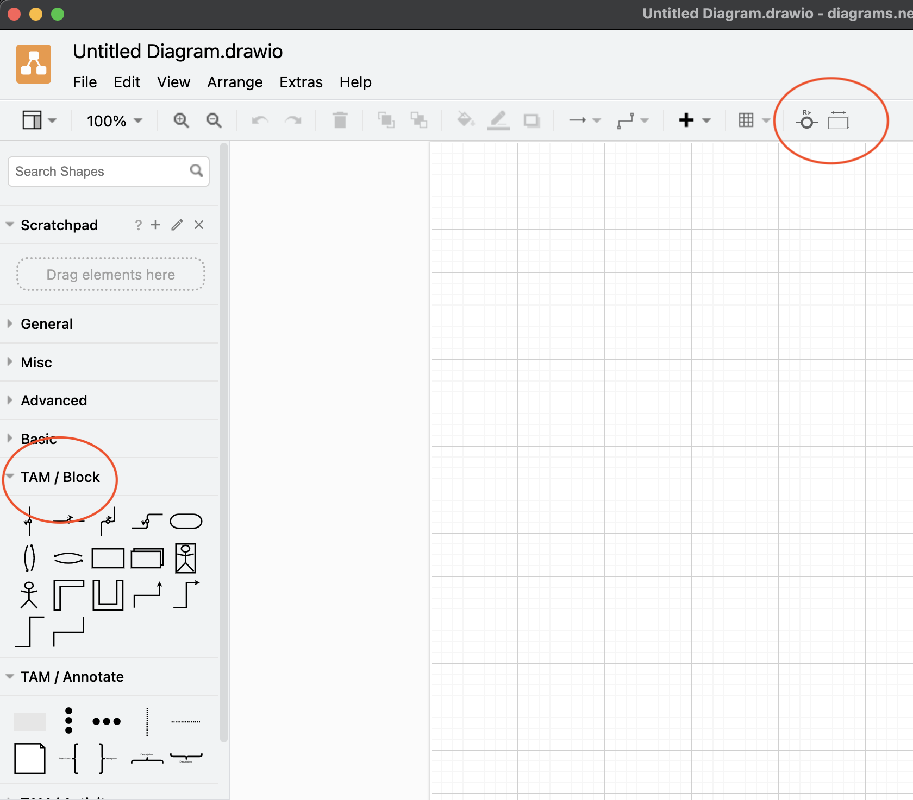

# tam-drawio
A [draw.io](https://github.com/jgraph/drawio) plugin which offers TAM notation


TAM is a subset of UML2 and FMC (Fundamental Modeling Concepts) block diagrams based on DIN 66200 - (Data processing systems operation; concepts, job relationships
STANDARD by Deutsches Institut Fur Normung E.V. (German National Standard), 03/01/1992)

For more information on TAM Notation, see [here](http://www.fmc-modeling.org/notation_reference)

draw.io is an open-source for web-based diagramming tool. It can be downloaded to run as a desktop application or consumed from [diagrams.net](https://app.diagrams.net/) 

This plugin adds some components to draw.io, which cover the common components used in TAM's block diagrams.


## How to install

- First you need to have the file `tam-drawio.js` on your local file system
- Simple way to do so is to clone this repo: `git clone https://github.com/ariel-bentu/tam-drawio`

### Install in draw.io desktop

Since draw.io Desktop v31.5.3, the Plugins dialog and `--enable-plugins` flag are fully removed. The only way to use this plugin is to patch it directly into the draw.io app bundle using the script below.

**Step 1 — Install draw.io Desktop** (if you haven't already):
- Mac: `brew install --cask drawio` or download from [get.diagrams.net](https://get.diagrams.net)
- Windows / Linux: download from [get.diagrams.net](https://get.diagrams.net)

**Step 2 — Patch the app bundle** using the platform-specific instructions below.

#### Mac — automated patch script (recommended)

Run the patch script once from the cloned repo:

```bash
bash install-tam-mac.sh
```

That's it. Open draw.io normally — no special launcher or command-line arguments. The script patches the installed draw.io app by:
1. Extracting the app bundle's `app.asar`
2. Adding `tam-drawio.js` to the built-in plugins folder inside it
3. Patching the app's preload to register the plugin in draw.io's settings automatically
4. Re-signing the app with a self-owned code-signing certificate stored in your login keychain

> **Security note:** The script re-signs draw.io with a locally-trusted, self-owned certificate. Apple's original notarisation no longer applies, but the bundle is protected against unauthorised modifications — any change to the app after signing will break the signature. The certificate is created on first run and reused on subsequent installs. The tam-drawio project and its contributors accept no liability for issues arising from this modification, including security vulnerabilities, data loss, or app instability. The script will ask you to confirm before making any changes.

> **Prerequisites:** macOS seals signed app bundles, so the script requires `sudo` and your terminal app must have **App Management** permission (`System Settings → Privacy & Security → App Management`). You will also be prompted once to allow keychain access for the signing certificate.

> **After a draw.io update:** the auto-updater replaces `app.asar`, removing the plugin. Re-run `install-tam-mac.sh` after each draw.io update. A background watcher is installed automatically and will prompt you when this happens.

> **Uninstalling:** run `bash uninstall-tam-mac.sh` to remove the plugin from the app bundle and unload the update watcher. If you delete draw.io without uninstalling first, run the uninstall script afterwards anyway — it will skip the asar step and still clean up the watcher.

#### Windows / Linux

As of draw.io Desktop v31.5.3 the `--enable-plugins` flag is removed on all platforms. A Windows/Linux install script equivalent to the Mac one above is not yet included here — contributions welcome. As a workaround, an older release of draw.io Desktop (pre-v31) with `--enable-plugins` support can be downloaded from the [releases page](https://github.com/jgraph/drawio-desktop/releases).

If you are on an older version where `--enable-plugins` is available:
- Goto Menu `Extras->Plugins...`
- Press `Add`
- Browse and select `tam-drawio.js`
- Press `Apply`
- Restart draw.io


> in some cases if you re-install the plugin, you get the error "File Already Exists". then go to the `<appData>/draw.io/plugins` and remove the file manually before re-installing.

```
<appData> is:
- %APPDATA%   on Windows
- $XDG_CONFIG_HOME or ~/.config   on Linux
- ~/Library/Application Support   on macOS
```


#### Note for Draw.io 21.3.0 release and after!!!
- The Sidepanel does not show the TAM elements in Dark mode.
- Select Light mode and restart.

### Install in VSCode
- Assuming you have Drawio vs-code extension. If not: [Get It](https://marketplace.visualstudio.com/items?itemName=hediet.vscode-drawio)
- Open the Settings
- Search for `plugins`
- Find the `Draw.io Integration` under `Extensions`
- Select the `Hediet > VSCode-drawio: Plugins`
- Choose to `edit in Settings.json`
- Add an entry to the array:
```
"hediet.vscode-drawio.plugins": [
    {"file":"path/to/file/tam-drawio.js"}
]
```
- Restart VSCode
- You will be prompted to Allow this plugin (once ever)
- Allow and you are good to go

### Install in app.diagrams.net
- `app.diagrams.net` has restricted allow-list for the plugin source domains and script checksums, 
  which prevents plugin from being added in a standard way (via `Extras --> Plugins...`)
- As a workaround the [bookmarklet](https://en.wikipedia.org/wiki/Bookmarklet) may be used. 
    - Navigate to the [page with bookmarklet link](https://ariel-bentu.github.io/tam-drawio/) and
      drag the link to the bookmark bar of your  browser.
    - Every time you visit https://app.diagrams.net, click on the bookmark before you open
      or create new diagram. That will install plugin for the current editor session.
- If anyone has an idea how to permanently enable plugin in `app.diagrams.net`, please speak-up

### Verify installation
An installation is successful, if you see TAM's new toolbar side-pannels, and 2 new buttons in the toolbar (as depicted in this screenshot).



### Configuration:
- Adding hidden text in the model for those who do not have the plugin:

#### Desktop version
Menu Extras --> Configuration
```json
{
  "globalVars": {
    "tam": {
      "addPluginMissingLabel": true
    }
  }
}
```

#### VSCode
Add the following entry in the VSCode `settings.json` (<kbd>F1</kbd> --> `Preferences: Open Settings (JSON)`)
```
"hediet.vscode-drawio.globalVars": {
  "tam": {
    "addPluginMissingLabel": true
  }
}
```

## Usage tips
- When using the using-edge (the line with circle and "R" and arrow), you can flip the direction by selecting the edge and pressing the new button on the toolbar (tooltip: Flip Use Direction).
- Use direction and side, can be controlled by the Style.

### Flow Animation
The plugin supports animated flowing dots on connectors to visualize data or control flow direction.

Two toolbar buttons control animation:

- **Toggle Edge Animation** (single-dot icon) — cycles the selected connector(s) through four animation states:
  - `none` — no animation
  - `fwd` — dots flow forward (left-to-right / top-to-bottom)
  - `rev` — dots flow in reverse
  - `both` — two simultaneous flows in opposite directions

  The button is enabled whenever one or more connectors are selected (works on use-edges and all other TAM connectors). The animation state is saved as part of the diagram (persisted in the cell style as `animated=fwd/rev/both`).

- **Toggle Global Animation** (three-dots icon) — master on/off switch for all animation in the diagram. Starts enabled by default. Toggling it off pauses all animated connectors without changing their individual settings.

- If you send the model to another person, that other person would need the TAM plugin to view it properly.

Therefore, the plugin adds a hidden text saying: `Best viewed with the TAM plugin` with a link to this repo. This text field is hidden as long as you have the plugin installed. Anyone without a plugin, will see this text item. (this is also hidden in the svg representation of a model).

To disable this behavior, see the configuration section above
- You may save a diagram file as "editable vector image (.svg)", then it gets saved as an svg with the drawio diagram embedded. this is useful for embedding into markdown files without maintaining two files - one for the diagram source and one for embedding into markdown.

## Contribution
Contributions are welcome. open Issues, submit pull-requests etc.

## Credits
- Special thanks to [micellius](https://github.com/micellius) for improving the code, contributing the bookmarklet concept for the online option, improving the settings and more. 

## Development
To modify cloned/downloaded version of `tam-drawio` plugin, you don't need to run any build step.
However, if you plan to contribute your change, you need to run the script that updates links in documentation. 

### Debug
The best way to debug the code is to load the plugin on an html version of draw.io. here are the steps:
- clone draw.io (`https://github.com/jgraph/drawio`) into a sibling folder to this project. (so `../drawio` would find it)
- Copy the tam-drawio.js into `../drawio/src/main/webapp/plugins`
- Modify `../drawio/src/main/webapp/index.html` this file by changing these two variables:
```
      ...
    if (urlParams['dev'] == '1')
		{
	    // Used to request grapheditor/mxgraph sources in dev mode
			var mxDevUrl = document.location.protocol + '//localhost:8080/';
			
			// Used to request draw.io sources in dev mode
			var drawDevUrl = document.location.protocol + '//localhost:8080/';
		
```
- Run: `node drawio.js` and access the server `http://localhost:8080?dev=1`
- Now use the browser debugger to debug the plugin.


### Prerequisites
- Download and install [Node.js](https://nodejs.org/en/download/) (≥16.14.0)
- Install dependencies by running `npm install` in the root directory of this repository

To update the bookmarklet and download links in documentation, please run
```
npm run pages
```
after changing `tam-drawio.js`, before pushing the code.
